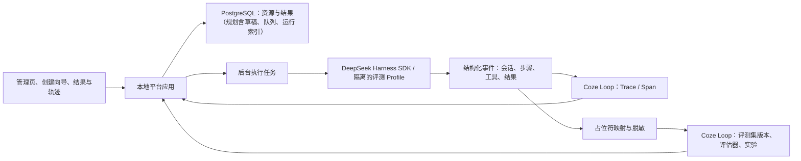

# EasyEval 产品需求文档

**状态**　平台业务库已切换为 PostgreSQL，资源管理、导入和结果读取 API 可连接同一个数据库。演示前端仍使用模拟数据，真实评测链路待联调。

**更新日期**　2026-11-26（Asia/Shanghai）

**项目负责人**：发起人。使用者包括评测配置人员、排查失败的 Agent 开发者和后续维护 Agent。

项目入口见 [EasyEval 使用说明](readme.md)。接手项目时先读本文件、[plan.md](plan.md) 和 [update.md](update.md)。本文件定义需求与验收，计划定义实施顺序，更新文档记录决策、变更、验证和回退。涉及界面的工作须遵循 [design.md](design.md)。任何 Agent 改动项目后，都必须在同一次交付中追加更新记录。

## 本地交互演示

用 Chrome 打开 [demo/index.html](demo/index.html) 即可。单文件包含管理页、四步向导、独立批次结果页和轨迹详情，支持在浏览器内读取 CSV 与 `.xlsx`。从「过程质量回归评测」进入历史批次 `RUN-002`，可核对五条模拟样本与整批 `37.5%` 均分。Agent 执行、裁判评分、AI 建规则与调度状态均为本地模拟，浏览器存储可用时会保留草稿和演示数据。

## 被测 Agent 和裁判模型的接入位置

截至 2026-11-25，本平台尚未调用真实裁判模型。演示页的 `makeJudgment` 按预设样本生成评分。后端 `scoreSample` 读取已经保存的裁判响应，按规则解释 JSON、核对指标并计算批次统计。[演示页](demo/index.html) · [评分契约](src/result-contract/contract.ts)

| 角色 | 配置位置 | 联调时核对什么 |
| --- | --- | --- |
| 被测 Agent（DeepSeek Harness） | 在 Harness 配置其自身的模型凭据。若新增的是供平台调用的 HTTP API，后续由平台运行器接入该地址及鉴权。 | 输入一条 query，取得回答和同一次执行的 Trace 引用。 |
| 裁判模型（Coze Loop Prompt 评估器） | 在本机 Docker Compose 的模型配置里的 `models` 列表注册模型，填写唯一正整数 `id`、展示名 `name`、供应商 `protocol`、`protocol_config.model` 和 `protocol_config.api_key`。自定义接入地址按协议填写 `base_url`。在 Coze Loop 的 Prompt 评估器中选择该模型并发布版本，平台接入时由评测规则引用已发布的评估器版本。 | 让该评估器为一条已有回答和轨迹试评分，核对实际返回的模型信息、总分、各指标和原始 JSON。 |

本仓库固定的 Coze Loop 版本随附名为 `doubao` 的 Ark 模板，接入点与密钥是占位符。若选 DeepSeek 作裁判，可按供应商示例配置，选择支持评估器所需工具调用的模型，并确认 `evaluator` 场景可用。实际密钥只写入本机部署配置，保留在 Git 提交和浏览器之外。[Compose 模型配置](https://github.com/coze-dev/coze-loop/blob/7a5ab1633eb30396928cd51017a63b456d117985/release/deployment/docker-compose/conf/model_config.yaml) · [DeepSeek 配置示例](https://github.com/coze-dev/coze-loop/blob/7a5ab1633eb30396928cd51017a63b456d117985/release/deployment/docker-compose/conf/model_config_example/deepseek.yaml) · [评估器执行代码](https://github.com/coze-dev/coze-loop/blob/7a5ab1633eb30396928cd51017a63b456d117985/backend/modules/evaluation/domain/service/evaluator_source_prompt_impl.go)

## 启动 PostgreSQL 后端

本地开发和多人部署都使用 PostgreSQL 17。部署时将私有连接地址写入后端环境变量 `DATABASE_URL`。浏览器只访问平台 API。每条任务、规则、数据集与结果都从有效会话取得账号归属。Coze Loop 上游组件继续使用各自的部署配置。

本地启动需要 Node.js 24、npm 和运行中的 Docker Compose。在项目根目录执行下列命令。

```sh
npm ci
cp -n .env.example .env
```

首次设置时，在 `.env` 中把 `POSTGRES_PASSWORD` 和连接地址里的 `REPLACE_WITH_PASSWORD` 填成同一段随机十六进制密码。已有 PostgreSQL 实例时，直接设置 `DATABASE_URL`，从 `npm start` 开始即可。

```sh
docker compose up -d --wait db
npm start
```

服务启动时自动迁移数据库，默认监听 `127.0.0.1:8080`。访问 `GET /api/health` 可检查连接。在另一终端执行 `npm run --silent session:create -- alice` 可以为本地联调签发 24 小时有效的个人令牌，再用 `Authorization: Bearer <令牌>` 请求 `GET /api/resources/dataset`。只有持有后端数据库凭据的操作者能签发。面向最终用户的注册或登录页仍待开发。

数据库采用 Compose 命名卷。单独执行迁移用 `npm run db:migrate`。共享部署时，为平台分配仅可访问其业务库的数据库账号，后端通过 `DATABASE_URL` 连接私网或托管实例，用户只需要网站地址。旧 SQLite 适配器保留用于读取旧文件和回归测试。若另有旧文件，切换前单独备份并核对迁移数据。

## 本地开发检查

运行 `npm run typecheck` 和 `npm test`。另用 `TEST_DATABASE_URL` 指向专用 PostgreSQL 测试库执行 `npm run test:postgres`。集成测试在该库中新建独立 schema，结束时清理本次创建的 schema。

## 目标和一期范围

给 DeepSeek Harness 做一个支持个人账号隔离的单轮离线评测平台。开发时可以在自己电脑上运行，推广时由多人访问同一个后端。使用者能从表格导入样本、创建评测规则、独立预览 Agent 调用与评估器打分、批量或定时跑评测，并从异常分数定位到对应样本和工具调用。首条验收链路为「导入样本 → 预览轨迹 → 规则取值 → 试评分 → 正式运行 → 结果和轨迹」。

- 已确认首个评测对象是桌面上的 DeepSeek Harness，允许后续在项目内的独立副本加埋点。
- 已确认创建任务只保存。详情页支持手动运行，启用定时后到点运行。
- 已确认飞书导出 Excel／CSV，SQL 上传已导出的查询结果 CSV。两者一次性生成本地快照，分别标记来源。
- 已确认 Coze Loop 本体一期使用本机 Docker Compose 部署。
- 已确认 DeepSeek Harness 使用隔离的评测 Profile，首版只开放无副作用的测试工具。
- 一期暂缓多轮会话、对比评测、飞书和企业微信通知、飞书链接授权、实时数据库连接。单轮指每条样本向 Agent 提交一次用户输入，Agent 内部仍可进行多次模型或工具调用。
- 当前已实现的代码和待验证环节见开发计划。下文标为「建议」的行为由项目负责人评审后定稿。

## 个人账号与数据归属

一期支持多个个人账号使用同一平台。每份用户内容都归一个账号，只有本人可以查看、使用和管理。团队协作和跨账号分享留待后续。账号从何处开通、采用哪种登录方式，待接入时确定。

- 登录后，新账号看到空的个人列表。任务、数据集与上传文件、评测规则及其版本、向导草稿、预览和试评分均归创建账号。创建任务时，只能选择或复制自己的资源。
- 手动和定时运行均归任务所有者。批次、样本、评分 JSON、Agent 与裁判的 Trace、Span、Agent Loop 和 Trajectory 继承同一归属。列表、筛选候选、总数、汇总和资源引用提示只反映本人的数据。
- 打开详情或轨迹链接仍需登录并核对归属。访问他人资源时显示「内容不可用」。退出或换号后，旧页面、浏览器返回和未完成请求都不能重新显示前一账号的内容。

## 管理页

评测任务、数据集、评测规则三个平行 Tab。三个列表都显示 ID、名称、创建时间、创建人和操作。支持按这些字段筛选，默认创建时间倒序，同一时间用 ID 稳定排序，列表可分页。点击名称进入查看。创建人取创建时的登录账号，创建人筛选仅包含本人。运行记录另外显示手动或定时触发。

| Tab | 操作与要求 |
| --- | --- |
| 评测任务 | 新建、查看、复制、修改、删除。复制直接生成带新 ID 的配置副本，成功后提示「已复制」。建议副本沿用源配置所引用的版本，定时默认关闭，运行记录留在原任务。修改使用右侧约三分之一屏抽屉，提供取消和确认。建议一期可改任务名称、数据集版本、规则版本和定时配置，提交前重新验证字段映射。已运行任务的历史不受修改影响。 |
| 数据集 | 新建、查看、复制、删除。查看时显示来源、固定版本、列、行数和样例。建议复制生成独立逻辑 ID，并引用同一份不可变内容，之后可各自导入新版本。导入新版本的入口待确认。 |
| 评测规则 | 新建、查看、复制、修改、删除。查看显示提示词、变量、评分标准、输出契约和模型配置。修改发布新版本，任务显式选择后才切换；复制生成独立规则。 |

建议删除为确认后归档。任务归档同时停用未来调度，已有运行仍可查询。被活跃任务绑定的数据集、规则禁止归档，并显示引用任务。运行中的任务先等运行结束或取消后归档。历史仍持有曾使用的版本和运行详情。任务详情支持查看当前配置、手动运行、停用定时、查看历史批次和逐条结果。

**归档后端契约（2026-11-25 固化）**　一期按冻结版本归档数据集、规则与任务，只标记状态、不删除版本、单元格或历史运行。数据集／规则版本被未归档任务引用时拒绝归档，并返回引用任务的 ID、版本和名称供界面提示；归档任务的冻结版本后不再允许基于该版本发起新运行，已归档的数据集／规则版本不能用于新建任务。归档后原归属仍可读取详情与历史结果。归档记录按账号隔离，越权与不存在的资源统一表现为查不到。管理页的删除确认、归档开关与引用任务提示界面尚未实现。

## 创建评测任务

四步都由服务端验证必填内容，控件提供字段级错误。上一步保留草稿，抽屉取消只撤销抽屉内未确认的编辑。建议刷新后可恢复当前本地草稿，确认取消整份草稿时清理其临时引用。更改上游输入时保留可复用的表单内容，并标明受影响的预览、变量和试跑结果需要更新。

| 环节 | 要求 |
| --- | --- |
| 1. 任务配置 | 任务名称、评测场景必填。场景由预配置列表提供，一期至少有 DeepSeek Harness，并关联模型、运行配置和能力。类型一期为单轮。可设定周期任务；建议一期支持每天或每周指定时间，显示 Asia/Shanghai 和下一触发时间。多轮、对比、通知明确标为后续能力。操作为取消、下一步。 |
| 2. 创建数据集 | 数据集名称与数据集选择必填。选已有集时用其名称和版本；新建使用右侧半屏抽屉，选来源、文件、工作表和字段映射，取消或确认。支持 Excel（建议首版接收 .xlsx）、CSV、飞书导出的 Excel／CSV、SQL 结果 CSV。导入先预览列、样例、解析错误和行数，显式指定非空文本查询列，检查失败时保留草稿以供修正。确认后预览数据并异步调用已选 Agent，按固定行顺序取最多 3 条，分别显示状态和轨迹链接。操作为取消、上一步、下一步。 |
| 3. 创建规则 | 规则名称和规则选择必填。新建使用右侧半屏抽屉，支持手动和 AI 辅助两种模式，提供取消和确认。手动输入带占位符的提示词、评测标准、评分和输出要求；AI 根据目标与字段生成可编辑草稿，由用户确认保存。页面显示数据集预览和规则预览，可把每个占位符映射到数据集列、Agent 输出或允许的 Trace 埋点。用第 1 条预览样本展示实际取值，失败时显示该行的错误，并允许重跑该样本。操作为取消、上一步、下一步。 |
| 4. 任务确认 | 汇总任务配置、数据集版本、规则版本、变量映射和调度。提供可选「试运行」按钮，取最多 2 条样本，展示实际映射、评分、理由、错误和轨迹。可直接确认创建。操作为取消、上一步、确认创建。 |

### 预览、试运行与正式评测

- 建议只有明确确认导入或进入可运行状态时才自动启动 3 条预览。切换下拉选项、回退和重复点击均不重复触发同一批 Agent 调用。配置变化时，通过场景版本、数据集版本、样本和查询映射判断是否仍可复用。数据量不足时显示实际条数。
- 第 2 步执行 Agent 并采集轨迹。第 4 步跑规则评分，优先复用配置匹配的前 2 条 Agent 结果。缺少匹配结果时才执行对应的 Agent 样本。它们使用草稿标识，与正式运行记录隔离。规则变动只使评分预览失效。
- 建议数据集字段和必需占位符必须可映射；预览时出现缺失、类型不符或多个候选必须显式提示。评测时缺值的样本标为评分失败。用户跳过试跑仍可保存已通过静态校验的配置，页面标注映射未经试评分验证。缺失和解析失败不计为零分。
- 建议一期每次任务绑定一个规则版本。统一评分字段由计划中的兼容性验证确认，产品提议为分数、解释和可选证据引用。建议使用 0–100 分，记录评估模型和评分失败原因。证据引用必须指向实际可见的步骤或埋点，模型生成的文本不能自行证明证据存在。

**试评分后端契约（2026-11-26 固化）**　第 4 步的试评分只取草稿冻结样本的前 2 条，按账号、草稿与样本建索引。每条记录绑定规则版本、变量映射与当前 Agent 预览签名；仅规则版本变化只让评分预览失效，场景／数据集／查询列／映射／样本变化同时让既有 Agent 结果不再可复用。同签名条目直接复用，不重复调用评估器；缺少匹配且成功的 Agent 预览时，先执行该样本的 Agent 再评分。记录只保留状态、逐条尝试、评分结果（可空总分、理由与规则原始 JSON）与 Trace 引用，不写任务版本或正式运行，也不把 Agent 输出复制进评分条目。取消或到期的草稿不展示旧试评分结果；归属只取服务端会话，越权与不存在统一表现为查不到。本轮仅固化领域契约与内存实现，真实评估器调用、HTTP 与持久化留待后续增量。

## 运行结果与查看轨迹

任务详情 → 一次运行 → 一条样本 → 轨迹。数据集预览和任务试跑也能到达同一个样本轨迹视图，返回时保留原上下文。运行详情显示批次 ID、触发方式、开始／结束时间、样本总数、成功、失败与取消数量。成功评分可聚合，页面明确均分分母，失败样本保留错误阶段和最近一次执行尝试。样本列表至少有行标识、查询、实际回复、分数、理由、耗时及轨迹链接。建议提供按失败状态筛选和取消运行，取消时保留已完成样本。

| 视图 | 同一条样本的查看方式 |
| --- | --- |
| Trace | 根据父子关系展示技术 span 树。显示 span 名称、类型、时间和状态，支持展开后查看脱敏输入输出、工具参数／结果摘要及错误。模型、耗时、Token 有记录时显示。 |
| Agent Loop | 按 Harness 的 turn → step 展示模型调用以及属于该 step 的工具调用，同一 step 的并行工具保留并行关系。展示可观测的停止、失败和超时原因，缺少明确轮次信息时提示数据缺失。 |
| Trajectory | 从用户输入到最终回答的可读序列，呈现可见模型输出、工具调用／结果、错误和最终响应。步骤可跳回对应 span。第一版使用同一批结构化事件，便于和 Coze Loop 轨迹核对。 |

不采集模型隐藏推理。Trace 尚在上报、部分缺失、失败与到期分别提示，输出缺失时仍保留样本状态和已采集步骤。调用记录与评分失败分别标识。项目只展示和转交允许的脱敏字段。

## 架构提议



- 平台使用 TypeScript 后端与 PostgreSQL。多人共用服务时，每次读写都从有效会话取得个人账号并校验资源归属。后台队列是后续开发项。平台管理任务配置、定时、导入快照、规则草稿和运行关联。Coze Loop 管理已上报的 Trace、接收到的评测数据、评估器和实验结果。页面通过后端适配器访问，客户端不接触平台密钥或上游数据库。
- 建议首选由本地 Runner 调用 Harness，在每条 case 完成后送交标准化输入和输出，由 Coze Loop 评分。优先验证原生实验是否支持使用数据集里的已执行结果、映射后的变量以及原 trace ID。这样预览可复用已经完成的 Agent 调用，Harness 始终在受控环境执行。若正式评测无法沿这条路径复用引擎，再验证 Coze Loop 自定义 RPC Target 与回调。评估器写入与试评分也需要验证身份和 API，详见 [plan.md](plan.md)。
- 本地应用对接由本机 Docker Compose 运行的 Coze Loop，继续使用上游所需的基础服务。另一方案是在上游 Go／React 项目内增强原生页面，复用现有身份与内部接口，但产品改动和上游升级耦合，只有 API 路线证实受阻才考虑。由于目标是自有平台，纯使用 Coze Loop 原生页面只能用于接入验证。 [上游架构](https://github.com/coze-dev/coze-loop/wiki/3.-Architecture)
- 数据关系为「场景版本、数据集版本、规则版本、字段映射 → 任务配置版本 → 运行 → 样本 → 尝试」。每个版本用不可变 ID 标记，运行保存实际输入版本、触发身份和模型标识，通过内部 ID、上游实验 ID、Harness session ID、Trace ID 串联结果。预览至少以草稿指纹区分，生产运行每次重新执行。模型的远程版本或输出可能变化，保留实际记录和配置用于追溯。
- 首个场景使用隔离评测 Profile 和无副作用的测试工具，禁用外部写入、桌面操作与不受控的权限提升。建议用独立工作区和每样本新会话，设置时限、用量上限和定时重叠策略。失败写入可定位的阶段、原因和尝试号。

## 关键疑问与建议决策

| 待项目负责人确认 | 草案建议与影响 |
| --- | --- |
| 运行时机器会不会休眠，定时任务需要准点执行吗？ | 首期在本机验证多个个人账号的隔离。定时任务按上海时区，建议休眠期间错过的触发在恢复后记录，默认不补跑。若需全天候运行，再确定部署环境。 |
| 确认数据集会自动调用 Agent，单次允许多少时间和模型费用？ | 试跑控制并发、总时长和样本数，确认前提示会发起调用。超过预算及时中止并保留已有结果。 |
| 规则怎样算「好」？一期要不要多规则和通过阈值？ | 先用单规则和固定分数与理由，阈值若未设则只展示分数。先交一版真实的高、中、低样本，检验评估器是否与人工判断一致。若规则可给多个维度或规则，则结果表和聚合要在开发前重新定义。 |
| 测试环境与历史策略是什么？ | 确认首批脱敏样本、目标模型与裁判模型、运行预算、历史与 Trace 的保留期限。评测若含真实对话，先核对可发送给哪些模型服务。先给 Task 修改和归档按上文建议实施，超期时展示对应轨迹已到期。 |

## 验收标准

1. 三个 Tab 的四个筛选字段和默认排序正确。复制生成新 ID，并且任务复制不会发起正式运行。修改和删除边界可按历史数据与引用关系验证。
2. 用 Excel、CSV、飞书导出的表格、SQL 结果 CSV 导入同构样本。确认工作表和查询列；缺列、空查询和解析错误能定位。更换文件后历史运行仍可打开旧快照。
3. 四步必填都有校验，返回上一步保持草稿。数据集预览最多执行 3 条；规则正确展示第 1 条的映射；试评分最多执行 2 条并遵循复用条件；跳过试跑可创建且不触发正式运行。
4. 手动或到点触发后，在任务详情能查看批次和结果。重复提交同一触发不会生成多次正式运行。修改任务时，已有运行仍可查看原配置版本。
5. 用包含工具调用、两个内部 step 的单轮样本验证 Trace 树、Agent Loop 和 Trajectory 关联一致。另用上报延迟、缺失埋点、Agent 超时和评分失败的样本验证各自状态。
6. 使用测试 Profile 运行表格中的文本时，不触达个人工作区或真实外部写操作。在请求日志、Span 和评分输入中检查凭据与未经授权字段均未泄露。
7. 同一服务用两个个人账号验收。A 有数据时，新账号 B 的列表和统计仍为空。两人创建同名资源后各自完成一次评测并查看自己的结果。B 打开 A 的旧链接、引用或复制 A 的资源时均得不到内容，也不会产生运行或变更。换号后检查草稿、结果缓存及定时运行归属。

## 仓库与参考

| 本地路径 | 版本与用途 |
| --- | --- |
| [upstream/coze-loop](https://github.com/coze-dev/coze-loop/tree/7a5ab1633eb30396928cd51017a63b456d117985) | 官方独立克隆，评测与可观测性基线。版本 `v1.5.1`，commit `7a5ab1633eb30396928cd51017a63b456d117985`，Apache-2.0。 [发布说明](https://github.com/coze-dev/coze-loop/releases/tag/v1.5.1) |
| [upstream/deepseek-harness](https://github.com/deepseek-ai/deepseek-harness/tree/e8f7b93a344964de3dca1ace9e72b6e4d6de87cb) | 从桌面已有克隆拉取的独立 Git 副本，commit `e8f7b93a344964de3dca1ace9e72b6e4d6de87cb`，顶层 MIT。当前副本的 origin 指向桌面仓库，官方 URL 见链接。 [官方仓库](https://github.com/deepseek-ai/deepseek-harness) |

Harness SDK 已随源码提供。Coze Loop 的 JavaScript 上报 SDK 可在后续通过锁定版本的包管理器引入，或直接采用 Coze Loop 的 OpenTelemetry 接口，依据 P1 验证选择。 [Coze Loop SDK 接入说明](https://github.com/coze-dev/coze-loop/wiki/8.-Open-source-edition-uses-CozeLoop-SDK)

设计批准后按 [plan.md](plan.md) 开始 P1 技术验证。运行时变更分批合并，本地验证通过后再启用调度。回退先停触发和新执行，再按 [update.md](update.md) 恢复对应代码、配置和版本，保留可读取的历史。
